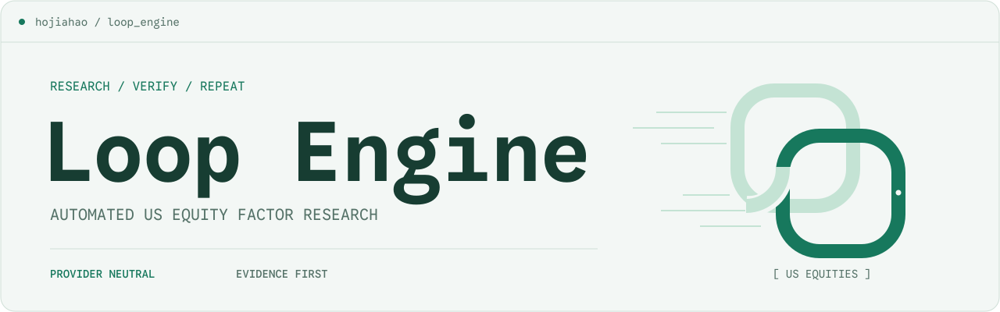
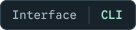
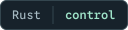
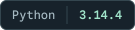

<p align="center">
  <picture>
    <source media="(max-width: 620px) and (prefers-color-scheme: dark)" srcset="docs/brand/banner-dark-compact.svg">
    <source media="(max-width: 620px)" srcset="docs/brand/banner-light-compact.svg">
    <source media="(prefers-color-scheme: dark)" srcset="docs/brand/banner-dark.svg">
    
  </picture>
</p>

<p align="center">美股因子研究 · 可恢复的模型执行 · 可追溯的评测证据</p>

<p align="center">
  <a href="#研究工作流"></a>
  <a href="#运行与恢复"></a>
  <a href="#数据与模型"></a>
  <a href="https://github.com/hojiahao/loop_engine/actions/workflows/ci.yml"></a>
  <br>
  <a href="crates/loopd"></a>
  <a href="apps/providerd"></a>
  <a href="python/loop_research"></a>
  <a href="docs/development/postgresql.md"></a>
</p>

<p align="center">
  <a href="#开始使用">开始使用</a> ·
  <a href="#研究工作流">研究工作流</a> ·
  <a href="#数据与模型">数据与模型</a> ·
  <a href="#运行与恢复">运行与恢复</a> ·
  <a href="#文档导航">文档</a>
</p>

---

Loop Engine 是面向美股横截面因子研究的可审计研究平台。研究人员可以生成因子候选，
在固定数据与交易假设下评测表达式，并通过独立计算核对统计与组合结果。
每次评测保留数据来源、代码与配置指纹；模型任务保留上下文、预算和执行回执。

它适用于因子假设验证、组合回测、独立复核和受控模型实验。通过研究 CLI、
`loopctl` 与授权 gRPC 服务使用各项能力。

## 核心能力

- **可追溯数据** — 获取行情与基本面，构造不可变 Parquet 快照，保存时间可见性、
  历史证券信息、交易日历与数据血缘。
- **确定性因子计算** — 规范 AST 与表达式标识，计算因果滚动算子和横截面变换，
  检查覆盖率，并登记试验与失败记录。
- **组合与统计评测** — 回放现金、持仓和 NAV，处理公司行动、借券、融资与交易成本；
  计算 IC、Rank IC、风险暴露和全局多重检验。
- **独立结果复核** — 使用 Alphalens 重算因子统计，使用 Zipline 独立回放组合，
  保存差异、来源和授权登记回执。
- **可插拔模型接入** — 原生协议、云部署、自托管与网关共用调用边界，支持工具消息、
  结构化输出和流式响应，每次调用固定模型、能力与价格快照。
- **可恢复模型执行** — 持久化任务状态、工具上下文和幂等回执；在固定计划和跨任务
  预算下，人工逐轮推进候选生成，重启后继续读取和操作原任务。

## 开始使用

支持 Linux x86-64。宿主需准备 C 编译器、链接器与开发头文件（Debian/Ubuntu 可安装
`build-essential`），以及 Node.js 24.17.0、Corepack、uv 0.11.29、curl、tar、xz 与
SHA-256 工具；`$HOME/.local/bin` 应在 `PATH` 中。
克隆仓库后，在根目录执行：

```bash
./scripts/bootstrap.sh
just build
just doctor
```

Bootstrap 按工具链清单和 lockfile 安装依赖。主研究环境使用 Python 3.14.4 与根
uv workspace；独立复核环境按兼容性单独锁定。工具版本、DaoCloud 容器和缓存位置见
[安装指南](docs/development/bootstrap.md)。`doctor` 检查本地组件，不启动研究任务。

查看实际命令入口：

```bash
./scripts/cargo.sh run --locked --offline -p loopctl -- --help
./scripts/uv-research.sh run --locked --offline --no-sync loop-research --help
```

接下来可按[数据指南](docs/development/development-data.md)准备研究输入，或按
[模型任务指南](docs/development/discovery-cli.md)配置服务、身份和固定计划。
研究数据、证书与凭据保存在私有目录中。

## 研究工作流

使用研究命令按以下顺序组织一次因子评测：

1. **准备数据**：验证源快照，按当时可见信息构造证券池与因子面板。
2. **确定表达式**：规范 AST、计算 SHA-256，冻结方向、参数与数据口径。
3. **评测因子**：计算因子值与横截面变换，检查覆盖率，登记试验。
4. **回放组合**：按下一可交易时点执行，计算成本后的持仓、收益和统计。
5. **独立复核**：从原始输入分别运行 Alphalens 和 Zipline，定位统计与账本差异。
6. **登记证据**：保存报告和回执，在统一准入路径检查权限、覆盖、试验历史及新鲜度。

每次研究留下可关联的快照、FactorSpec、试验记录、组合账本和复核报告。
具体输入与命令见[因子求值](docs/development/factor-evaluation.md)、
[组合回测](docs/development/portfolio-backtest.md)和
[授权复核](docs/development/authorized-reconciliation.md)。

## 研究完整性

研究结论依赖可核验的计算与数据条件：

| 约束 | 实现方式 |
| --- | --- |
| 时间可见性 | PIT 查询与因果算子；方向在 IS 确定，确认集使用独立权限与存储边界。 |
| 结果新鲜度 | 指标绑定代码、算子、配置、数据、日历和环境；依赖变化后结果失效。 |
| 试验完整性 | 保留失败记录与全局试验总体，采用 BY-FDR、DSR、CSCV/PBO 评估选择风险。 |
| 计算独立性 | Alphalens 复算统计，Zipline 独立回放；差异与不可用结果显式保留。 |
| 执行可追溯性 | PostgreSQL 事务、租约与幂等回执绑定状态变化、预算预留和审计。 |

数值一致性不等于经济有效性，多重检验也不能消除数据污染或幸存者偏差。
正式历史研究需要数据授权、历史覆盖与 PIT 质量验收；历史留出结果不称为前瞻结果。
Loop Engine 用于研究与回测，不提供实盘下单或收益承诺。

## 数据与模型

### 数据接入

| 数据源 | 研究用途 | 接入条件 |
| --- | --- | --- |
| SEC Company Facts | 申报数据开发验证 | 配置真实联系邮箱，无需 API key |
| Alpaca | 指定证券与 feed 的行情开发验证 | `LOOP_ALPACA_KEY_ID`、`LOOP_ALPACA_SECRET_KEY` |
| Nasdaq Data Link / Sharadar | 明确授权表的历史数据获取 | `LOOP_SHARADAR_API_KEY`、订阅与许可配置 |
| WRDS / CRSP / Compustat | 机构授权的数据获取 | WRDS 身份、数据权限与许可配置 |

具体步骤见[凭据接入](docs/development/data-credentials.md)、
[开发数据](docs/development/development-data.md)和[授权数据](docs/development/licensed-data.md)。
SEC 与 Alpaca 开发接入不代表完整历史证券池或退市覆盖；行情权限按实际 feed 记录。
API key 通过环境或 secret reference 注入，不写入 Git、日志或命令行参数。

### 模型接入

OpenAI Responses/Chat 和 Anthropic Messages 保留一级原生实现；Google、Cohere、
Bedrock、Azure 与 Vertex 使用对应协议或部署适配。Mistral、DeepSeek、Qwen、xAI、
Groq、Together、Fireworks、Cerebras、Perplexity、GLM、Kimi 和 MiniMax 有独立厂商配置。
兼容层覆盖 OpenAI/Anthropic-compatible、自托管服务和 LiteLLM、Portkey、OpenRouter 网关。

可用性取决于模型 ID、协议能力、账号、区域与权限；契约验证和真实账号验证分别记录。
接入方法见[原生协议](docs/development/native-providers.md)、
[云部署](docs/development/cloud-providers.md)、[厂商插件](docs/development/vendor-providers.md)
和[兼容服务](docs/development/compatible-providers.md)。

## 运行与恢复

`loopctl run` 在固定计划下启动并人工逐轮推进候选生成任务，跨子任务保存步数、token、
费用和时间预算。安装客户端、配置 mTLS 身份并由管理员登记研究计划后，可执行：

```bash
loopctl run --config /absolute/private/operator.json start \
  --plan /absolute/private/run-plan.binpb --key start.research.001
loopctl run --config /absolute/private/operator.json status --run RUN_ID
loopctl run --config /absolute/private/operator.json step \
  --run RUN_ID --revision REVISION --key step.research.001
```

使用响应中的真实 `RUN_ID` 和 `REVISION`。每次 `step` 最多推进一轮；新任务先预留
完整预算，重复命令与重启不会重置预留。预算预留与估计费用不等同于实际账单。
完整配置与回执语义见[研究运行 CLI](docs/development/research-runs-cli.md)。

单个 Discovery 任务通过独立客户端身份查看和控制：

```bash
loopctl discovery --config /absolute/private/client.json status --job JOB_ID
loopctl discovery --config /absolute/private/client.json events --job JOB_ID
```

暂停、取消、恢复和审计查询见[Discovery 操作指南](docs/development/discovery-cli.md)。
不确定是否已经计费的模型请求不会自动重新发送。

## 系统架构

控制、模型传输与数值研究分别承担明确职责，以 Protobuf/gRPC 交换控制消息。
数据和结果保存在不可变文件中，服务之间传递 URI、schema 与校验和。

| 组件 | 职责 | 实现 |
| --- | --- | --- |
| [loopctl](crates/loopctl) | 本地诊断、模型任务与有限轮候选运行 | Rust、Clap |
| [loopd](crates/loopd) | 持久状态、权限、预算、研究执行与结果登记 | Rust、Tokio、SQLx |
| [providerd](apps/providerd) | 模型协议、认证、能力目录与调用状态 | TypeScript、Node.js |
| [loop_research](python/loop_research) | 数据处理、因子求值、组合账本与统计 | Python、Polars、Arrow、NumPy、SciPy |
| [独立统计](python/alphalens_validation) / [独立组合回放](python/zipline_validation) | 复算与对账 | Alphalens Reloaded、Zipline Reloaded |
| [元数据](migrations/postgres) / [服务契约](proto) | 事务与迁移、跨语言接口 | PostgreSQL、Protobuf/gRPC |

Provider 不读取研究数据库或留出数据；数值研究不实现厂商路由。
原始数据、研究视图与模型提示材料使用独立权限边界。

## 文档导航

| 要完成的任务 | 指南 |
| --- | --- |
| 搭建与检查环境 | [Bootstrap、工具链和容器](docs/development/bootstrap.md) |
| 获取和验证数据 | [凭据](docs/development/data-credentials.md) · [源快照](docs/development/source-snapshots.md) · [PIT 数据](docs/development/point-in-time-data.md) |
| 编写和计算因子 | [求值](docs/development/factor-evaluation.md) · [因果面板](docs/development/causal-factor-panels.md) · [横截面变换](docs/development/cross-sectional-transforms.md) |
| 评估和复核结果 | [组合回测](docs/development/portfolio-backtest.md) · [统计](docs/development/portfolio-statistics.md) · [全局试验](docs/development/global-statistics.md) · [独立复核](docs/development/authorized-reconciliation.md) |
| 配置模型与恢复调用 | [模型目录](docs/development/model-catalog.md) · [Provider 部署](docs/development/provider-runtime.md) · [调用恢复](docs/development/invocation-recovery.md) |
| 部署和维护服务 | [PostgreSQL](docs/development/postgresql.md) · [身份与数据权限](docs/development/runtime-authority.md) · [部署与回退](docs/development/production-cutover.md) |

## 开发与许可

开发规范见 [AGENTS.md](AGENTS.md) 和[命名与 Rust 规范](docs/development/rust-style.md)。
在完成 Bootstrap 的环境中运行 `just check`、`just test`、`just build` 与 `just doctor`；
完整集成测试需要 Docker，隔离与容器验收前提见安装指南。

本仓库当前未授予 MIT、Apache-2.0 或其他开源许可证。
第三方依赖、字体和数据分别遵循各自许可，历史作者信息及法定署名予以保留。
